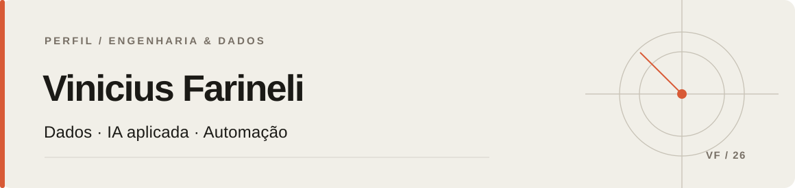

  

 

**Analista de Dados Sênior** · Curitiba, PR

[LinkedIn](https://www.linkedin.com/in/vinicius-farineli) &nbsp;·&nbsp; [Contato](mailto:viniciusfarineli@gmail.com)

---

Trabalho com dados desde 2021, entre operações de telecomunicações e indústria. Hoje, meu foco está em **IA aplicada a dados corporativos**: preparar e validar informações, estruturar o contexto de negócio e conectar agentes e modelos a sistemas que as pessoas já utilizam.

### Em que tenho trabalhado

**01 / IA generativa e agentes**  
Soluções com Databricks Genie, LLMs, consultas SQL validadas e regras de segurança. APIs em FastAPI para integração com fluxos corporativos, Microsoft Teams e WhatsApp.

**02 / Dados e modelos preditivos**  
Pipelines, automações e modelos de previsão, clusterização e análise de causa raiz aplicados à operação de redes de telecomunicações.

**03 / Visão computacional**  
Participação em projeto industrial de Machine Learning e visão computacional para estimar ângulos de corte e apoiar a melhoria do rendimento produtivo.

### Ferramentas

| Área | Tecnologias |
| :-- | :-- |
| Dados | Python · SQL · PySpark · Databricks · Airflow |
| IA e ML | Databricks Genie · LLMs · scikit-learn · Prophet · Vertex AI |
| APIs e entrega | FastAPI · REST · Docker · GitHub Actions · Azure · GCP |

### Formação

**Pós-graduação em Ciência de Dados e IA** · XP Educação, 2025  
**Bacharelado em Big Data e IA** · PUCPR, 2022
